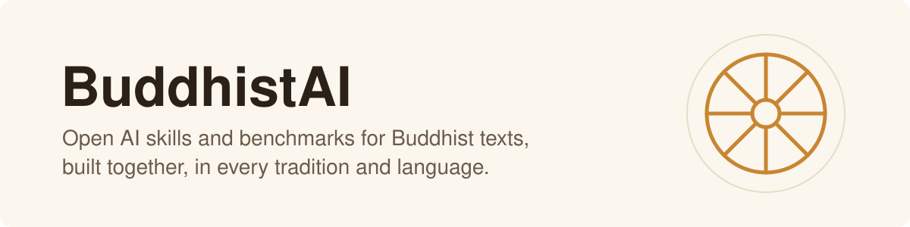

<picture>
  <source media="(prefers-color-scheme: dark)" srcset="./assets/banner-dark.svg">
  
</picture>

<p align="center">
  <a href="https://buddhistai.github.io/buddhist-benchmarks/"></a>
  <a href="https://huggingface.co/BuddhistAI"></a>
  <a href="https://github.com/orgs/BuddhistAI/discussions"></a>
  <a href="https://opensource.org/license/mit"></a>
</p>

**Welcome!** BuddhistAI is a shared, open home for AI skills and benchmarks that work with Buddhist texts. It belongs to everyone who takes part: monasteries, universities, translation groups, developers and researchers. New people and organizations are always welcome.

<table>
<tr>
<td width="33%" valign="top">

### 🏆 Leaderboard

See which skill and model work best for each task and language, and what they cost.

[**Open the leaderboard →**](https://buddhistai.github.io/buddhist-benchmarks/)

</td>
<td width="33%" valign="top">

### 🧰 Skills

Install the best skill for your language, one plugin per language.

[**Get the skills →**](https://github.com/BuddhistAI/buddhist-skills#install)

</td>
<td width="33%" valign="top">

### 📊 Benchmarks

Test sets and scorers for each task, plus [BuddhistBench](https://github.com/BuddhistAI/buddhist-bench) for how well AI knows the traditions.

[**See the benchmarks →**](https://github.com/BuddhistAI/buddhist-benchmarks)

</td>
</tr>
</table>

```bash
claude plugin marketplace add BuddhistAI/buddhist-skills
claude plugin install buddhist-skills-tibetan@buddhistai   # or -pali, -sanskrit, -classical-chinese, ...
```

## Get involved

- 🛠️ **Build a better skill or add test data:** score it on [buddhist-benchmarks](https://github.com/BuddhistAI/buddhist-benchmarks#scoring-a-skill), or see a [workshop repo](https://github.com/BuddhistAI/toc-extraction-tibetan) for how one is made.
- 🏛️ **Represent a tradition or institution?** Share [exam papers](https://github.com/BuddhistAI/buddhist-bench/blob/main/docs/exams.md) (with permission) or [write expert questions](https://github.com/BuddhistAI/buddhist-bench/blob/main/CONTRIBUTING.md) for BuddhistBench.
- 🔬 **Do research?** Read the plans and reports in [research](https://github.com/BuddhistAI/research).
- 💬 **Questions or ideas?** Start a thread in [Discussions](https://github.com/orgs/BuddhistAI/discussions), or open an issue in any repo.

## Repositories

| | |
| --- | --- |
| [**buddhist-skills**](https://github.com/BuddhistAI/buddhist-skills) | The best skill for each task and language, ready to install |
| [**buddhist-benchmarks**](https://github.com/BuddhistAI/buddhist-benchmarks) | Test sets, scorers and the [leaderboard](https://buddhistai.github.io/buddhist-benchmarks/) for skills |
| [**buddhist-bench**](https://github.com/BuddhistAI/buddhist-bench) | BuddhistBench: how well AI models know the Buddhist traditions, in many languages |
| [**toc-extraction-tibetan**](https://github.com/BuddhistAI/toc-extraction-tibetan) | Workshop for one skill: variants, runs and reports |
| [**research**](https://github.com/BuddhistAI/research) | Experiment plans and reports |

## Who's involved

BuddhistAI is built by the organizations and people who contribute to it. Everything is MIT licensed.

- [**WeBuddhist**](https://webuddhist.com): also runs [Buddhist AI Studio](https://buddhistai.tools/), the [AI Tools working group](https://forum.webuddhist.com/c/wg/ai-wg/36) on its forum, and a [Discord](https://discord.com/invite/7GFpPFSTeA)
- **Your organization?** Contribute a skill, a test set or exam papers, then [add your name here](https://github.com/BuddhistAI/.github/edit/main/profile/README.md).
